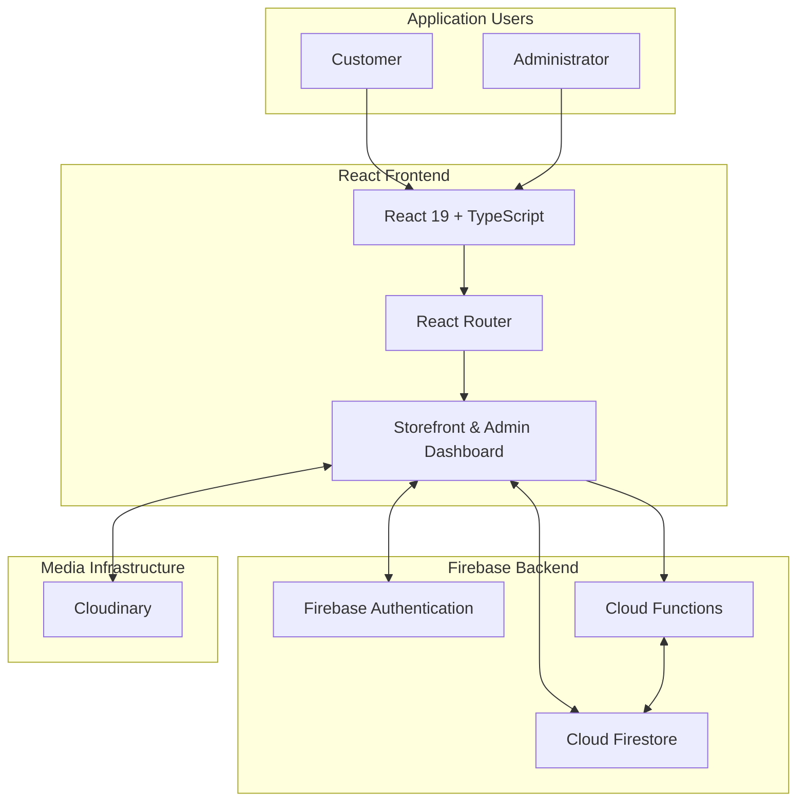
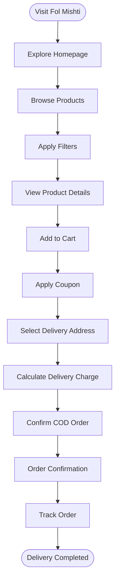
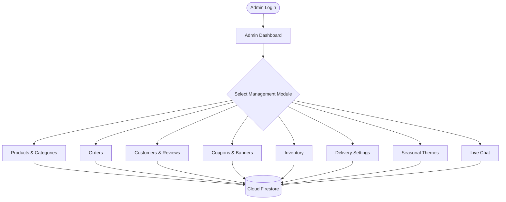
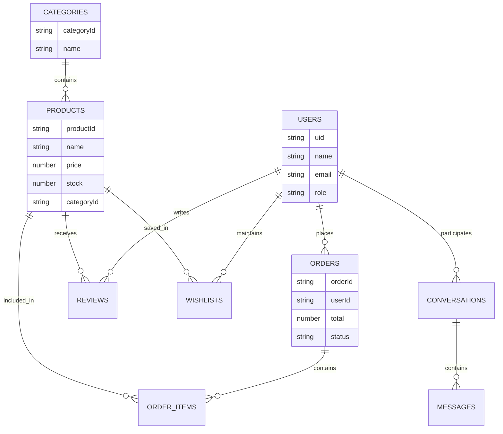
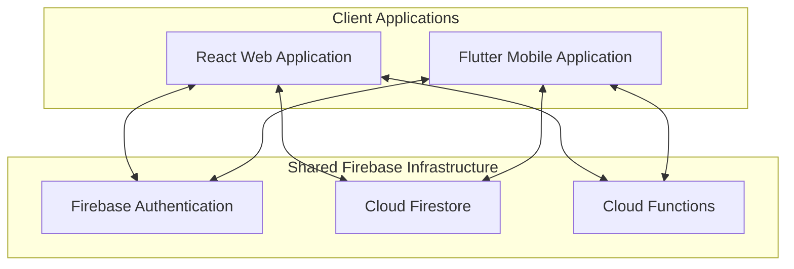

# 🍃 ফল মিষ্টি | Fol Mishti
### Seasonal Fruits & Traditional Bengali Sweets E-Commerce Platform

<p align="center">
  <strong>বাংলার প্রকৃতির সতেজ ফল, ঐতিহ্যের খাঁটি মিষ্টি — পৌঁছে যাবে আপনার দোরগোড়ায়।</strong>
  <br/>
  <em>Freshness from Nature. Sweetness from Tradition.</em>
</p>

<p align="center">
  <a href="https://fol-misti-web-and-app-ecomarce-plat.vercel.app/">
    
  </a>
  <a href="https://github.com/suyabamin/fol_misti_web_and_app_ecomarce_platform">
    
  </a>
</p>

<p align="center">
  
  
  
  
  
  
</p>

<p align="center">
  <strong>Full-Stack E-Commerce • Real-Time Communication • Seasonal Branding • Admin Dashboard</strong>
</p>

---

## 📑 Table of Contents

- [Overview](#-overview)
- [Live Website](#-live-website)
- [Project Vision](#-project-vision)
- [Key Features](#-key-features)
  - [Customer Storefront](#1--customer-storefront)
  - [Product Management](#2--product-discovery-and-management)
  - [Shopping Cart and Checkout](#3--shopping-cart-and-checkout)
  - [Order Management](#4--order-management-and-tracking)
  - [Customer Account](#5--customer-account-and-wishlist)
  - [Seasonal Theme System](#6--dynamic-seasonal-theme-system)
  - [Real-Time Live Chat](#7--customer--admin-live-chat)
  - [Admin Dashboard](#8--comprehensive-admin-dashboard)
- [Technology Stack](#-technology-stack)
- [System Architecture](#-system-architecture)
- [Application Workflow](#-application-workflow)
- [Database Design](#-database-design)
- [Project Structure](#-project-structure)
- [Local Installation](#-local-installation-and-setup)
- [Environment Configuration](#-environment-configuration)
- [Firebase Setup](#-firebase-setup)
- [Cloudinary Setup](#-cloudinary-setup)
- [Admin Access](#-admin-access)
- [Deployment](#-deployment)
- [Documentation](#-documentation)
- [Security](#-security-considerations)
- [Testing and Quality Assurance](#-testing-and-quality-assurance)
- [Mobile Application Roadmap](#-future-mobile-application)
- [Future Improvements](#-future-improvements)
- [Contributing](#-contributing)
- [Developer](#-developer)
- [License](#-license)

---

## 🌿 Overview

**ফল মিষ্টি (Fol Mishti)** is a modern, full-stack e-commerce platform designed to bring Bangladesh's seasonal fruits and traditional Bengali sweets to customers through a convenient online shopping experience.

The platform focuses on two important parts of Bengali food culture:

- 🍋 **Seasonal Fruits:** Fresh seasonal fruits sourced from gardens and orchards across Bangladesh.
- 🍬 **Traditional Bengali Sweets:** Authentic sweets made with traditional ingredients and the heritage of Bengali confectionery.

Fol Mishti combines an elegant customer storefront with a comprehensive administration system, real-time communication, inventory management, and dynamic seasonal branding.

The platform is built using React, TypeScript, Firebase, Cloud Firestore, Firebase Cloud Functions, and Cloudinary.

It is designed around a centralized backend architecture that can also support a future Flutter mobile application.

### 🎯 Core Objectives

1. Create a modern online shopping experience for seasonal fruits and traditional sweets.
2. Make product discovery and purchasing simple and convenient.
3. Provide customers with transparent order tracking.
4. Enable administrators to manage products, inventory, orders, customers, and promotions.
5. Introduce seasonal visual themes that reflect the availability of different products.
6. Provide real-time customer support.
7. Build a scalable backend for future web and mobile applications.

---

## 🌐 Live Website

<kbd>LIVE</kbd>

**Website:** https://fol-misti-web-and-app-ecomarce-plat.vercel.app/

**Source Code:** https://github.com/suyabamin/fol_misti_web_and_app_ecomarce_platform

The live website provides access to the Fol Mishti storefront and its available application features.

---

## ✨ Key Features

## 1. 🛍️ Customer Storefront

The customer-facing storefront provides an organized shopping experience with a modern Bengali-inspired visual identity.

### Homepage

- Attractive hero banner.
- Seasonal product highlights.
- Special Mango Season promotional section.
- Traditional Bengali sweets collection.
- Featured and popular products.
- Customer reviews and testimonials.
- Trust and service information badges.
- Promotional banners and product highlights.

### Responsive Design

- Desktop-friendly layouts.
- Tablet optimization.
- Mobile-responsive storefront.
- Modern product cards.
- Smooth interactions and navigation.

### Customer Information Pages

The platform includes dedicated information and policy pages:

- About Us.
- Contact Us.
- Frequently Asked Questions (FAQ).
- Shipping Policy.
- Return and Refund Policy.
- Privacy Policy.
- Terms and Conditions.

---

## 2. 🍋 Product Discovery and Management

Customers can browse and discover products using multiple filtering and sorting options.

### Product Browsing

- Category-based product browsing.
- Product search and discovery.
- Price range filtering.
- Rating-based filtering.
- In-stock product filtering.
- Popularity-based sorting.

### Product Details

Each product can display:

- High-quality product images.
- Bengali product name.
- English product name.
- Product description.
- Product price.
- Stock availability.
- Weight and measurement unit.
- Customer ratings.
- Customer reviews.

### Product Categories

The platform supports products from two primary collections:

| Collection | Examples |
|---|---|
| Seasonal Fruits | Mango, Orange, Lychee and other seasonal fruits |
| Traditional Sweets | Fresh Chhana-based Bengali sweets |

---

## 3. 🛒 Shopping Cart and Checkout

The shopping cart provides customers with a convenient purchasing workflow.

### Shopping Cart

- Add products to cart.
- Update product quantities.
- Remove products.
- Calculate item subtotals.
- Display order totals.
- Apply available promotional coupons.

### Discount Coupons

The platform includes two promotional coupon codes:

| Coupon | Description |
|---|---|
| `FOL20` | Promotional discount coupon |
| `MISHTI100` | Promotional discount coupon |

Actual discount eligibility and calculation are determined by the configured coupon rules.

### Delivery Charge Calculation

Delivery charges are calculated according to the configured delivery areas.

### Payment Method

**Cash on Delivery (COD)** is supported as the documented checkout payment method.

### Order Confirmation

Customers can confirm their orders through the checkout process.

---

## 4. 📦 Order Management and Tracking

Fol Mishti provides an order history and order progress tracking experience.

### Four-Step Order Tracking


| Stage | Description |
|---|---|
| Order Placed | Customer successfully submits an order. |
| Processing | Order is being prepared. |
| Shipping | Order has entered the delivery process. |
| Delivered | Order has been delivered. |

### Order Features

- Canonical order ID.
- Order history.
- Order status tracking.
- Delivery progress.
- Order cancellation subject to eligibility.
- Order information and details.

---

## 5. 👤 Customer Account and Wishlist

Customers have access to account-related shopping features.

### Account Management

- Customer profile.
- Saved delivery addresses.
- Previous order history.
- Order information.

### Wishlist

- Save favorite products.
- Maintain a personalized product list.
- Quickly revisit preferred products.

---

## 6. 🎨 Dynamic Seasonal Theme System

One of the distinctive features of Fol Mishti is its administrator-controlled seasonal theme system.

Administrators can change the website's visual identity according to the current fruit season or promotional campaign.

### Available Themes

<details>
<summary><strong>🌲 1. Fol Mishti Signature — Default Theme</strong></summary>

- Primary color: Forest Green.
- Accent color: Golden.
- Color code: `#156b3c`.
- Inspired by freshness, nature, and trust.

</details>

<details>
<summary><strong>🥭 2. Mango Season Theme</strong></summary>

- Primary accent: Golden Mango Yellow.
- Color code: `#f59e0b`.
- Complementary fresh green.
- Designed for Bangladesh's mango season.

</details>

<details>
<summary><strong>🍊 3. Orange Season Theme</strong></summary>

- Primary accent: Citrus Orange.
- Color code: `#ea580c`.
- Complementary cream and green.
- Inspired by fresh citrus fruits.

</details>

<details>
<summary><strong>🍒 4. Lychee Season Theme</strong></summary>

- Primary accent: Lychee Pink-Red.
- Color code: `#e11d48`.
- Complementary green.
- Inspired by seasonal lychee collections.

</details>

<details>
<summary><strong>🍬 5. Mishti Festival Theme</strong></summary>

- Primary accent: Royal Maroon.
- Color code: `#881337`.
- Golden complementary accents.
- Inspired by traditional Bengali sweets and festivals.

</details>

### Theme Management Workflow

1. Administrator opens the seasonal theme settings.
2. Selects a preferred theme.
3. Previews the visual changes.
4. Confirms the selection.
5. Theme settings are saved in Cloud Firestore.
6. Updated theme settings are reflected across the customer storefront through the application's real-time synchronization.

**Important:** Seasonal theme switching is restricted to authorized administrators.

---

## 7. 💬 Customer–Admin Live Chat

Fol Mishti includes a real-time customer support system.

### Customer Support Widget

- Floating live support button.
- Customer-to-admin messaging.
- Message history.
- Interactive support interface.

### Admin Support Inbox

- Active conversation list.
- Customer message history.
- Reply interface.
- Customer profile sidebar.
- Conversation management.

### Real-Time Communication

Cloud Firestore real-time listeners synchronize conversation data so that new messages can appear without requiring a manual page refresh.

---

## 8. 📊 Comprehensive Admin Dashboard

Fol Mishti includes an administration dashboard with dedicated management modules.

### Dashboard Analytics

Administrators can monitor:

- Total revenue.
- Total orders.
- Pending orders.
- Low-stock alerts.
- Sales charts.
- Store activity.

### Product Management

- Create products.
- Read product information.
- Update product details.
- Delete products.
- Upload product images through Cloudinary.
- Activate or deactivate products.

### Category Management

- Create categories.
- Update categories.
- Remove categories.
- Manage category information.

### Order Management

- View orders.
- Filter orders.
- Update order status.
- Manage delivery progress.
- Print invoices.

### Customer Management

- View customer information.
- Access customer-related records.
- Manage customer reviews.
- Moderate submitted reviews.

### Promotion Management

- Create and manage discount coupons.
- Configure promotional banners.
- Manage homepage sliders.

### Inventory Management

- Monitor product stock.
- Update inventory quantities.
- Detect low-stock products.
- Display inventory warnings.
- Synchronize stock changes with relevant application data.

### Delivery Management

- Configure delivery zones.
- Set delivery charges.
- Manage delivery-related settings.

---

## 🛠️ Technology Stack

Fol Mishti uses a modern JavaScript and Firebase-based architecture.

### Frontend

| Technology | Purpose |
|---|---|
| React 19 | Component-based UI development |
| Vite | Development server and build tooling |
| TypeScript | Type-safe application development |
| React Router 7 | Client-side navigation |
| CSS3 | Custom responsive styling |
| Noto Sans Bengali | Bengali typography |
| Hind Siliguri | Bengali typography |
| Poppins | English typography |

**Design Philosophy:** The frontend uses custom CSS3 rather than Tailwind CSS or Bootstrap.

### Backend and Database

| Technology | Purpose |
|---|---|
| Firebase Authentication | User authentication |
| Cloud Firestore | Application database |
| Firebase Cloud Functions | Server-side application logic |
| TypeScript | Backend development |

### Media Management

| Technology | Purpose |
|---|---|
| Cloudinary | Product image and media management |

### Deployment

| Platform | Purpose |
|---|---|
| Vercel | Frontend hosting |
| Firebase | Backend services and database |

---

## 🏗️ System Architecture

Fol Mishti follows a frontend-backend architecture with Firebase as its central backend infrastructure.



### Architecture Responsibilities

| Layer | Responsibility |
|---|---|
| Presentation Layer | Customer storefront and admin interface |
| Routing Layer | Application page navigation |
| Authentication Layer | User identity and authentication |
| Database Layer | Products, orders, users, reviews and settings |
| Serverless Backend | Trusted server-side business operations |
| Media Layer | Product and promotional images |

---

## 🔄 Application Workflow

### Customer Shopping Workflow



### Admin Management Workflow



---

## 🗄️ Database Design

Fol Mishti uses Cloud Firestore as its primary NoSQL database.

The database is designed to organize the major entities of an e-commerce application.

### Core Data Entities

| Entity | Purpose |
|---|---|
| Users | Customer and administrator information |
| Products | Product descriptions, prices and inventory |
| Categories | Product category information |
| Orders | Customer purchases and order status |
| Reviews | Customer feedback and ratings |
| Wishlists | Saved customer products |
| Coupons | Promotional discount configurations |
| Banners | Homepage promotional content |
| Settings | Store configuration and active theme |
| Conversations | Customer support conversations |
| Messages | Individual chat messages |
| Delivery Zones | Delivery area and charge configuration |

### Simplified Entity Relationship



*This diagram illustrates the conceptual data relationships, not a guarantee of exact Firestore collection or field names.*

---

## 📁 Project Structure

The repository is organized into separate frontend, backend, Firebase configuration, and documentation directories.

```text
fol_misti_web_and_app_ecomarce_platform/
│
├── web/
│   └── React + Vite + TypeScript Frontend
│
├── functions/
│   └── Firebase Cloud Functions (TypeScript)
│
├── firebase/
│   └── Firestore Security Rules & Indexes
│
├── docs/
│   ├── api-contract.md
│   ├── database-schema.md
│   ├── firebase-setup.md
│   ├── cloudinary-setup.md
│   ├── security.md
│   ├── deployment.md
│   └── flutter-integration-guide.md
│
├── .env.example
├── .firebaserc
├── .gitignore
├── firebase.json
│
├── ARCHITECTURE.md
├── DESIGN.md
├── MEMORY.md
├── PRD.md
├── RULES.md
├── TASKS.md
├── progress.md
├── skill.md
│
└── README.md
```

---

## 🚀 Local Installation and Setup

Follow these instructions to run Fol Mishti on your local development machine.

### Prerequisites

Install the following tools:

| Tool | Purpose |
|---|---|
| Node.js | JavaScript runtime |
| npm | Dependency management |
| Git | Version control |
| VS Code | Recommended code editor |
| Firebase Project | Authentication and database |
| Cloudinary Account | Product image management |
| Firebase CLI | Firebase configuration and deployment |

### Step 1 — Clone the Repository

```bash
git clone https://github.com/suyabamin/fol_misti_web_and_app_ecomarce_platform.git
```

### Step 2 — Navigate to the Project

```bash
cd fol_misti_web_and_app_ecomarce_platform
```

### Step 3 — Configure Environment Variables

Create a `.env` file in the repository root using `.env.example` as a reference.

Add the required Firebase and Cloudinary configuration.

See the [Environment Configuration](#-environment-configuration) section.

### Step 4 — Install Frontend Dependencies

```bash
cd web
npm install
```

### Step 5 — Start the Development Server

```bash
npm run dev
```

Open the following address in your browser:

```text
http://localhost:5173
```

### Step 6 — Install Backend Dependencies

Open another terminal:

```bash
cd functions
npm install
```

### Step 7 — Build Firebase Cloud Functions

```bash
npm run build
```

The TypeScript backend will be compiled according to its configured build process.

---

## 🔐 Environment Configuration

The repository provides a root `.env.example` file.

Create a local `.env` file and configure the required variables.

### Firebase Configuration

```env
VITE_FIREBASE_API_KEY=your_firebase_api_key

VITE_FIREBASE_AUTH_DOMAIN=your_project_id.firebaseapp.com

VITE_FIREBASE_PROJECT_ID=your_project_id

VITE_FIREBASE_STORAGE_BUCKET=your_project_id.appspot.com

VITE_FIREBASE_MESSAGING_SENDER_ID=your_messaging_sender_id

VITE_FIREBASE_APP_ID=your_firebase_app_id
```

### Cloudinary Configuration

```env
VITE_CLOUDINARY_CLOUD_NAME=your_cloud_name

VITE_CLOUDINARY_UPLOAD_PRESET=your_unsigned_upload_preset
```

### Important Environment Variable Notes

- Replace all placeholder values with your own project configuration.
- Do not commit private credentials or service account keys.
- Firebase web configuration is not a replacement for proper Firebase Security Rules.
- Cloudinary upload presets must be configured with appropriate restrictions.
- Server-side secrets must be stored in a secure backend environment, not exposed through `VITE_` variables.

---

## 🔥 Firebase Setup

Fol Mishti uses Firebase for authentication, database operations, and server-side functionality.

### Step 1 — Create a Firebase Project

Visit:

https://console.firebase.google.com/

Create a new Firebase project.

### Step 2 — Enable Authentication

Configure the authentication providers required by the application.

### Step 3 — Create Cloud Firestore

Create a Firestore database and configure the appropriate security rules.

### Step 4 — Configure Firestore Indexes

Use the index configuration included in the repository's Firebase directory.

### Step 5 — Configure Firebase CLI

Install Firebase CLI:

```bash
npm install -g firebase-tools
```

Authenticate:

```bash
firebase login
```

Initialize or select the appropriate Firebase project:

```bash
firebase use --add
```

### Step 6 — Deploy Firebase Resources

Review the Firebase configuration before deploying.

```bash
firebase deploy --only firestore:rules,firestore:indexes
```

Deploy Cloud Functions separately after verifying their configuration:

```bash
firebase deploy --only functions
```

---

## ☁️ Cloudinary Setup

Cloudinary is used for product image and promotional media management.

### Step 1 — Create an Account

Visit:

https://cloudinary.com/

### Step 2 — Access Dashboard

Obtain your Cloudinary cloud name.

### Step 3 — Configure Upload Preset

Create an upload preset with suitable upload restrictions.

### Step 4 — Configure Environment Variables

```env
VITE_CLOUDINARY_CLOUD_NAME=your_cloud_name

VITE_CLOUDINARY_UPLOAD_PRESET=your_upload_preset
```

### Step 5 — Test Image Upload

Verify that authorized product image uploads work correctly.

**Security reminder:** Never expose Cloudinary API secrets or unrestricted upload permissions in frontend code.

---

## 🔑 Admin Access

The project documentation provides the following demo administrator login details:

| Field | Value |
|---|---|
| Email | `admin@folmishti.com` |
| Password | Any 6-character password (documented demo behavior) |

**Important:** These credentials describe the development/demo login behavior provided with the project. They must not be treated as production authentication credentials.

For production deployment:

- Use real Firebase Authentication.
- Verify administrator roles securely.
- Enforce admin-only permissions through backend authorization and Firestore Security Rules.
- Never rely solely on frontend route protection.
- Remove or disable demo authentication shortcuts.

---

## 🚀 Deployment

The customer-facing web application is deployed on Vercel.

### Frontend Deployment with Vercel

**Step 1:** Open https://vercel.com/

**Step 2:** Import the GitHub repository.

**Step 3:** Configure the frontend project.

Set the frontend root directory to:

```text
web
```

**Step 4:** Configure environment variables.

Add the required Firebase and Cloudinary configuration to the Vercel project.

**Step 5:** Configure the build settings according to `web/package.json`.

For a standard Vite application:

```text
Build Command: npm run build
Output Directory: dist
```

**Step 6:** Deploy the application.

Vercel will build and deploy the frontend.

### Backend Deployment

Firebase Cloud Functions should be deployed independently using Firebase CLI.

```bash
firebase deploy --only functions
```

Before deployment, verify:

- Firebase project selection.
- Cloud Functions environment configuration.
- Firestore Security Rules.
- Firestore indexes.
- Cloudinary upload restrictions.
- Authentication and administrator permissions.

---

## 📚 Documentation

The repository contains additional technical documentation for developers.

| Document | Description |
|---|---|
| [Architecture](ARCHITECTURE.md) | System architecture and technical structure |
| [Design](DESIGN.md) | UI/UX and design guidelines |
| [Product Requirements](PRD.md) | Product requirements and functional scope |
| [Rules](RULES.md) | Project development rules |
| [Tasks](TASKS.md) | Development task tracking |
| [Progress](progress.md) | Project implementation progress |
| [Memory](MEMORY.md) | Project context and development notes |
| [Skill](skill.md) | Project-specific development guidance |
| [API Contract](docs/api-contract.md) | API and backend contract |
| [Database Schema](docs/database-schema.md) | Database structure |
| [Firebase Setup](docs/firebase-setup.md) | Firebase configuration |
| [Cloudinary Setup](docs/cloudinary-setup.md) | Image upload configuration |
| [Security Guidelines](docs/security.md) | Security recommendations |
| [Deployment Guide](docs/deployment.md) | Deployment instructions |
| [Flutter Integration](docs/flutter-integration-guide.md) | Future mobile application integration |

---

## 🛡️ Security Considerations

Security is important for any e-commerce platform.

Fol Mishti uses Firebase Authentication and Cloud Firestore, but production security also depends on correct configuration.

### Recommended Security Practices

1. Enforce authentication for protected operations.
2. Implement role-based authorization.
3. Restrict administrative operations to verified administrators.
4. Validate product prices and order totals on trusted server-side code.
5. Validate coupon eligibility on the backend.
6. Prevent unauthorized inventory modification.
7. Validate order cancellation eligibility.
8. Apply appropriate Firestore Security Rules.
9. Protect server-side secrets.
10. Restrict Cloudinary uploads.
11. Avoid trusting frontend-provided user roles.
12. Maintain backups of important business data.

### Production Readiness

Before accepting real customer orders, verify that checkout, pricing, stock updates, order creation, and administrator permissions are enforced by trusted backend logic.

---

## 🧪 Testing and Quality Assurance

Recommended verification steps before deploying changes:

### Frontend

```bash
cd web
npm install
npm run build
```

Run available project checks:

```bash
npm run
```

Review the available scripts in `web/package.json` before running specific tests or lint commands.

### Backend

```bash
cd functions
npm install
npm run build
```

### Functional Testing Checklist

- [ ] Homepage loads correctly.
- [ ] Product browsing works.
- [ ] Product filters work.
- [ ] Product details display correctly.
- [ ] Shopping cart calculations are correct.
- [ ] Coupon validation works.
- [ ] Delivery charge calculation works.
- [ ] COD order submission works.
- [ ] Order tracking works.
- [ ] Customer account functionality works.
- [ ] Wishlist functionality works.
- [ ] Seasonal themes synchronize correctly.
- [ ] Customer-admin chat works.
- [ ] Admin product management works.
- [ ] Order status updates work.
- [ ] Inventory updates work.
- [ ] Cloudinary uploads work.
- [ ] Unauthorized administrative access is blocked.

---

## 📱 Future Mobile Application

Fol Mishti is designed with a centralized backend architecture that can support a future Flutter mobile application.

The goal is to reuse the same authoritative Firebase backend instead of creating a separate mobile-only database.

### Planned Flutter Features

- [ ] Android application.
- [ ] iOS application.
- [ ] Customer authentication.
- [ ] Product browsing.
- [ ] Shopping cart.
- [ ] Order placement.
- [ ] Order tracking.
- [ ] Wishlist synchronization.
- [ ] Push notifications.
- [ ] Live customer support.
- [ ] Shared customer accounts between web and mobile.

### Planned Architecture



---

## 🚀 Future Improvements

Potential improvements for the Fol Mishti ecosystem include:

### E-Commerce Enhancements

- [ ] Online payment gateway integration.
- [ ] Advanced promotional campaigns.
- [ ] Automated invoice generation.
- [ ] Customer loyalty and reward points.
- [ ] Advanced product recommendations.

### Customer Experience

- [ ] Push notifications.
- [ ] Improved product search.
- [ ] Personalized shopping recommendations.
- [ ] Better accessibility.
- [ ] Multi-language content expansion.

### Business Management

- [ ] Advanced sales analytics.
- [ ] Exportable financial reports.
- [ ] Supplier management.
- [ ] Purchase and stock management.
- [ ] Delivery partner integration.
- [ ] Automated customer notifications.

### Platform Expansion

- [ ] Flutter mobile application.
- [ ] Shared authentication across platforms.
- [ ] Mobile push notifications.
- [ ] Offline-friendly product browsing.

---

## 🤝 Contributing

Contributions, suggestions, and improvements are welcome.

### Contribution Workflow

1. Fork the repository.
2. Clone your fork.
3. Create a feature branch.
4. Implement your changes.
5. Test your implementation.
6. Submit a Pull Request.

### Create a Feature Branch

```bash
git checkout -b feature/your-feature-name
```

### Commit Changes

```bash
git add .
git commit -m "feat: describe your changes"
```

### Push Changes

```bash
git push origin feature/your-feature-name
```

Please follow the existing architecture, coding conventions, and security guidelines.

---

## 👨‍💻 Developer

**Suyab Amin Sunny**

Computer Science & Engineering Student | Software Developer

<p align="left">
  <a href="https://github.com/suyabamin">
    
  </a>
  <a href="https://www.linkedin.com/in/suyab-amin-sunny-b30454327/">
    
  </a>
</p>

### Project Links

- **Repository:** https://github.com/suyabamin/fol_misti_web_and_app_ecomarce_platform
- **Live Website:** https://fol-misti-web-and-app-ecomarce-plat.vercel.app/

---

## ⚖️ License and Copyright

**© Fol Mishti. All Rights Reserved.**

ফল মিষ্টি একটি স্বতন্ত্র ব্র্যান্ড ও সফটওয়্যার প্রকল্প।

Unless otherwise authorized in writing by the project owner, copying, redistribution, commercial reuse, or modification for redistribution is not permitted.

---

<p align="center">
  <strong>🍃 ফল মিষ্টি | Fol Mishti</strong>
  <br/>
  <em>Freshness from Nature. Sweetness from Tradition.</em>
  <br/><br/>
  বাংলাদেশের মৌসুমি ফল ও ঐতিহ্যবাহী মিষ্টির ডিজিটাল ঠিকানা।
  <br/><br/>
  <strong>Made with ❤️ in Bangladesh 🇧🇩</strong>
  <br/>
  <sub>Powered by React, TypeScript & Firebase</sub>
</p>
